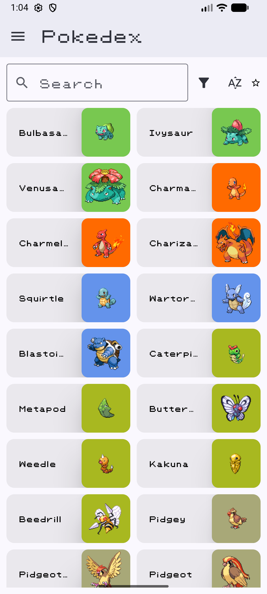
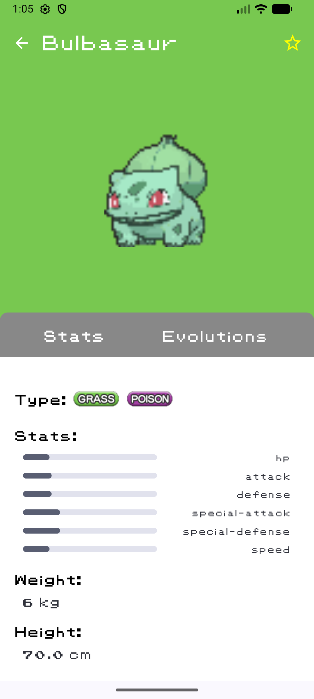
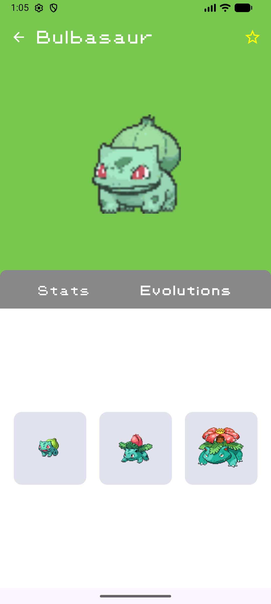

<p align="center"></p>

<p align="center">
  
  
  
  
  
  
  
  
</p>
<p align="center">
  <a href="https://github.com/Pelosin/Pokedex/actions/workflows/ci.yml"></a>
</p>

A native Android Pokédex built with **Kotlin and Jetpack Compose**, structured with **Clean Architecture**: browse every Pokémon in a card grid, open rich detail pages, favourite the ones you catch, and keep browsing even offline.

## ✨ Features

- 📱 **Pokémon grid** — scrollable card list, 2 columns, type-coloured cards
- 🔎 **Search & filters** — live search by name and favourites filter
- 📊 **Detail pages** — stats, attributes, type and evolution chain per Pokémon
- 🔔 **Recommendation notifications** — periodic Pokémon recommendations, straight from the app
- 💾 **Offline cache** — Pokémon data stored with Room, available without connection
- 🎬 **Splash screen & first-run welcome** — splash screen API + first-time-only welcome
- 🌗 **Material 3 theming** — dark/light, type-based card colours, GIF support (Coil)

## 📸 Screenshots

| Welcome | Pokédex list |
|---|---|
|  |  |
| **Pokémon details** | **Evolutions** |
|  |  |

## 🏛 Architecture

```
┌──────────────────────────────┐
│  UI (Jetpack Compose, M3)     │  Screens, composables, ViewModels + StateFlow
├──────────────────────────────┤
│  Domain                       │  Models (Pokemon, Stats, Type, Evolution)
│                               │  Repository interfaces
├──────────────────────────────┤
│  Data                         │  PokemonRepository (impl)
│   ├─ Remote: Retrofit/PokeAPI │
│   └─ Local: Room (offline)    │
└──────────────────────────────┘
        DI: Hilt (8 modules) · MVVM · UiState
```

Each layer only talks to the one below it — ViewModels depend on domain interfaces, `data` provides the implementations, and Hilt wires it all together.

## 🛠 Tech stack

| Area | Choice |
|---|---|
| Language | Kotlin |
| UI | Jetpack Compose, Material 3, Navigation Compose, Splash Screen API |
| Architecture | Clean Architecture (data/domain/ui), MVVM, StateFlow |
| DI | Hilt (kapt) |
| Networking | Retrofit + Gson (PokeAPI) |
| Persistence | Room (offline cache) |
| Images | Coil (incl. GIF support), Accompanist |
| Testing | JUnit (data source & repository tests) |

## 📂 Project structure

```
app/src/main/java/com/example/mypokedex/
├── core/           # Application class
├── data/
│   ├── local/      # Room: entities, DAOs, database source
│   ├── remote/     # Retrofit: PokeApi, DTOs, remote source
│   ├── repository/ # PokemonRepository implementation
│   └── utils/      # Constants, FunctionResponse, prefs helper
├── di/             # 8 Hilt modules
├── domain/         # Models + repository interfaces
└── ui/
    ├── composables/  # Reusable composables (list, details, topbar…)
    ├── screens/      # FirstTime, Pokedex, Details, Error
    ├── viewmodels/   # MVVM ViewModels
    └── notifications/ # Recommendation notifications
```

## 🚀 Roadmap

- [ ] Multi-language support
- [ ] Data sync when back online
- [ ] About & Settings screens
- [ ] Sorting by type / evolution stage

## ▶️ Build & run

```bash
git clone https://github.com/Pelosin/Pokedex.git
cd Pokedex
./gradlew assembleDebug
# Install on device/emulator (API 35+)
adb install app/build/outputs/apk/debug/app-debug.apk
```

Requires JDK 17+ and Android SDK with platform 35.

## 📄 License

[MIT](LICENSE) © João Pelosi
